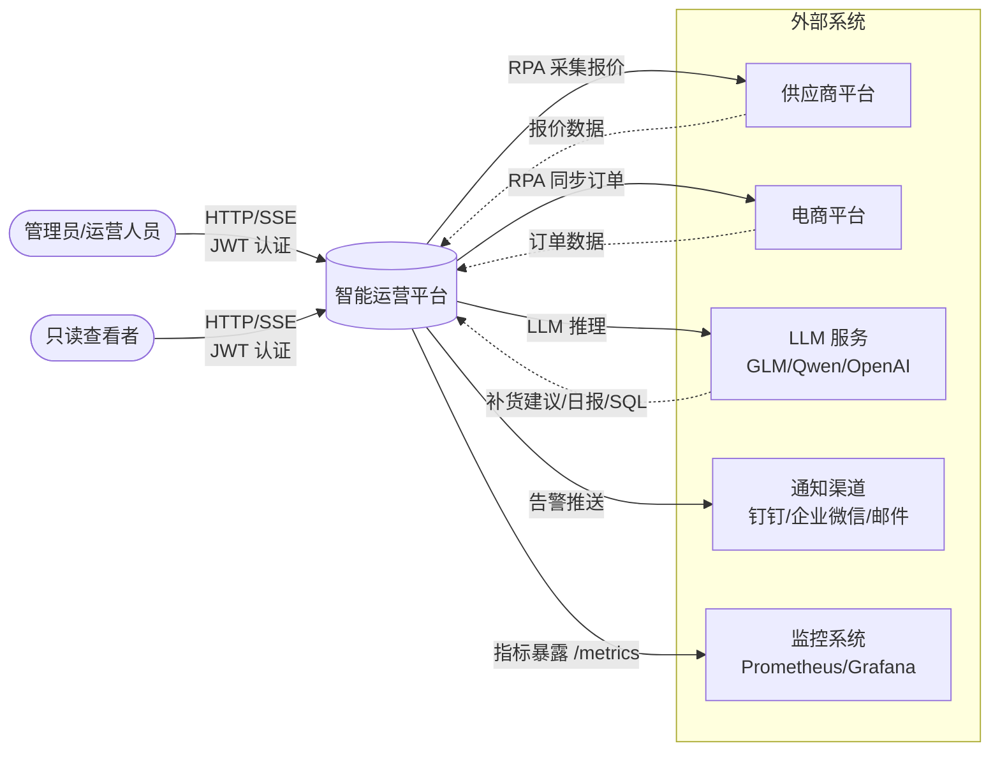
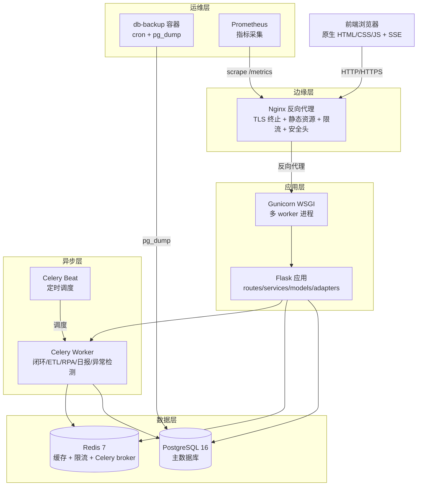
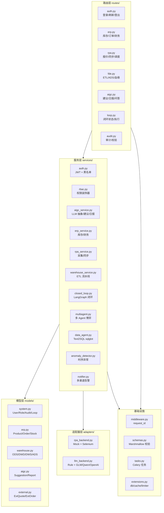
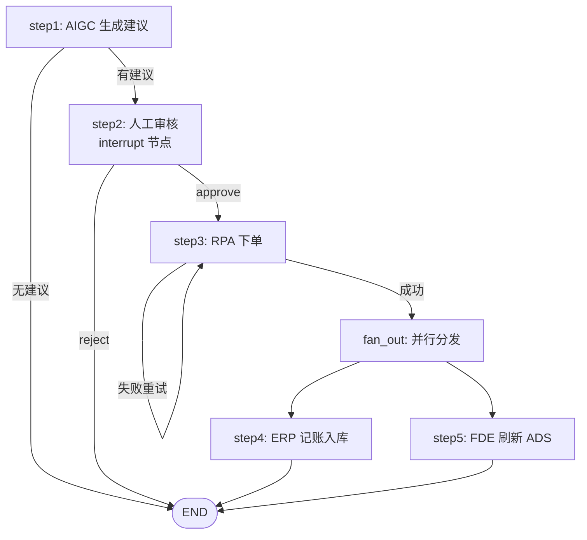
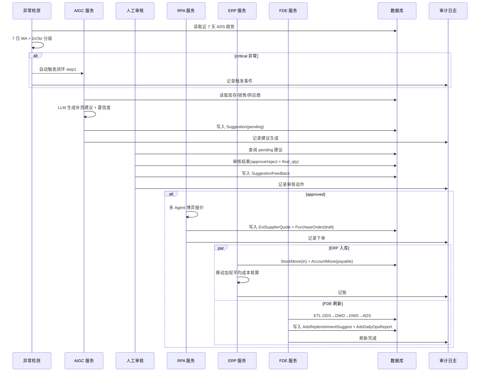
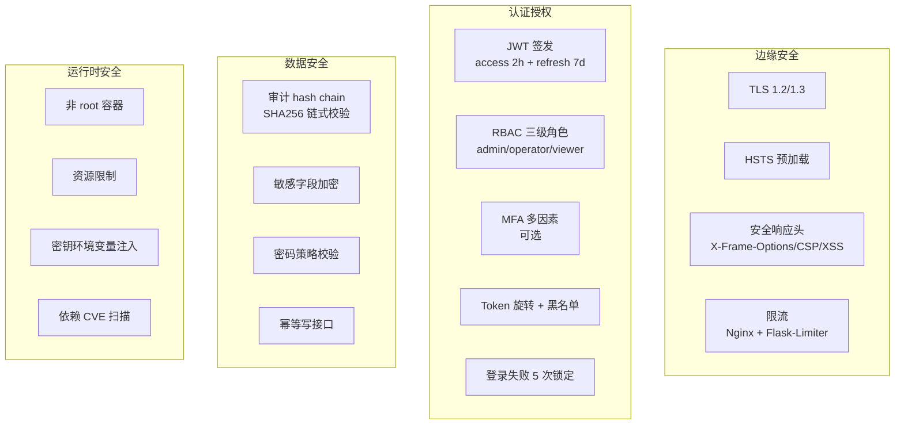

# 架构设计文档

> 中型企业智能运营平台 · RPA / ERP / FDE / AIGC 四层闭环协同架构

## 1. 项目概述

本平台是一个涵盖 **RPA、ERP、FDE、AIGC** 四大领域的小型可运行系统，通过四层闭环协同验证供应链自动化能力：

| 领域 | 职责 | 关键能力 |
|------|------|----------|
| **AIGC** | 智能生成 | LLM 抽象层 + 规则引擎兜底，生成补货建议、4 段式经营日报、Text2SQL 全链路、多 Agent 采购博弈 |
| **RPA** | 自动执行 | 供应商报价采集、电商订单同步，适配器模式支持 mock / selenium 切换 |
| **ERP** | 业务记账 | 产品/供应商/采购/销售/库存/财务科目管理，移动加权平均成本核算 |
| **FDE** | 数据沉淀 | ODS/DWD/DWS/ADS 四层数仓、ETL 流水线、数据质量监控、时序异常检测 |

四层通过**五步闭环状态机**协同：异常检测 → 建议生成 → 人工审核 → RPA 执行 → 结果校验，支持跨进程文件锁、超时处理、断点续跑、业务侧回滚补偿、异常自动触发。

## 2. C4 模型图

### 2.1 Context 图（系统上下文）

展示系统与外部参与者的关系：



**外部参与者说明**：

- **用户**：分三级角色 admin / operator / viewer，通过浏览器访问单页应用
- **供应商平台 / 电商平台**：RPA 适配器对接的外部系统，通过 mock 或 selenium 驱动
- **LLM 服务**：AIGC 模块依赖的推理后端，通过 `LLM_PROVIDER` 切换（rule / glm / qwen / openai）
- **通知渠道**：Notifier 异步推送告警与日报
- **监控系统**：抓取 `/metrics` 端点的 Prometheus 指标

### 2.2 Container 图（容器视图）



**容器清单**：

| 容器 | 镜像 | 职责 | 端口 |
|------|------|------|------|
| nginx | nginx:1.27-alpine | TLS 终止、静态资源、限流、安全头 | 80, 443 |
| web | 自构建（多阶段） | Gunicorn + Flask 应用 | 5000（仅容器内） |
| db | postgres:16-alpine | 主数据库 | 5432（仅容器内） |
| redis | redis:7-alpine | 缓存 + 限流 + Celery broker | 6379（仅容器内） |
| db-backup | 自构建 | 定时 pg_dump 备份 + 完整性校验 | - |
| celery worker | 复用 web 镜像 | 异步任务执行（可选） | - |
| celery beat | 复用 web 镜像 | 定时任务调度（可选） | - |

### 2.3 Component 图（组件视图）



**分层职责**：

| 层 | 职责边界 | 关键约束 |
|----|----------|----------|
| **routes/** | 参数解析、调用 service、返回响应 | 不含业务逻辑，不含 DB 操作 |
| **services/** | 业务逻辑封装、跨模型编排 | 不直接处理 HTTP，可调用 adapters |
| **models/** | SQLAlchemy 数据模型、表结构定义 | 不含业务逻辑，可含纯计算方法 |
| **adapters/** | 外部系统抽象（LLM / RPA） | ABC + 多实现，通过环境变量切换 |
| **middleware.py** | request_id 注入、日志过滤器 | 横切关注点 |
| **schemas.py** | Marshmallow 输入校验 | 与路由解耦 |
| **extensions.py** | db / cache / migrate / limiter / celery_app | 单例管理 |

## 3. 核心架构决策

### 3.1 为什么选 Flask 而非 Django / FastAPI

| 维度 | Flask | Django | FastAPI |
|------|-------|--------|---------|
| 学习曲线 | 低 | 高 | 中 |
| 异步支持 | 需 Gunicorn | 需 ASGI 配置 | 原生 |
| ORM 灵活度 | SQLAlchemy（灵活） | Django ORM（绑定） | SQLAlchemy |
| 中间件生态 | Blueprint 轻量 | 重 | 依赖注入 |
| 团队熟悉度 | 高 | 中 | 中 |

**决策理由**：

1. **轻量可控**：本项目模块边界清晰（routes/services/models/adapters），Flask 的 Blueprint 模型天然契合分层架构，避免 Django 的"大而全"约束
2. **SQLAlchemy 优先**：项目重度依赖 SQLAlchemy ORM（连接池配置、Alembic 迁移、复杂查询），Flask-SQLAlchemy 是最自然的组合
3. **同步模型足够**：核心场景是五步闭环状态机 + SSE 流式输出，Gunicorn 多 worker + 同步 worker_class 已能满足吞吐需求，无需 FastAPI 的异步复杂度
4. **生态匹配**：Flask-Caching / Flask-Limiter / Flask-Migrate / Flask-Cors / flask-smorest 都是成熟稳定的扩展，覆盖缓存、限流、迁移、CORS、API 文档需求

### 3.2 为什么用 LangGraph 做 Agent 编排

**问题背景**：五步闭环早期用硬编码 if-elif 状态机实现，存在以下痛点：

- 条件分支（无建议跳过审核、下单失败重试）散落在主流程中，难以维护
- 人工审核等待节点无法优雅表达
- step4（ERP 入库）与 step5（FDE 刷新）的并行执行需要手工线程管理

**LangGraph 方案**：



**决策理由**：

1. **声明式状态图**：用 `StateGraph` + `add_node` + `add_edge` 声明节点与边，条件分支用 `add_conditional_edges`，比 if-elif 更清晰
2. **interrupt 原语**：`interrupt()` 原生支持人工审核暂停-恢复语义，无需手工轮询 LoopState
3. **并行 fan-out**：`fan_out` 节点向 step4 + step5 同时建边，LangGraph 自动并行调度
4. **优雅降级**：`langgraph` 未安装时 `interrupt = None`，代码降级到 if-elif 硬编码，保证零依赖可运行
5. **可观测**：StateGraph 自带状态快照，便于调试与断点续跑

### 3.3 为什么用 sqlglot 替代 sqlparse

**问题背景**：Data Agent 的 Text2SQL 安全校验早期基于 `sqlparse`，用正则关键字匹配判断 SQL 类型，存在误判：

- 列名 `u.update` 被正则误判为 DML `UPDATE` 语句
- CTE 别名追踪用 70 行状态机实现，维护成本高
- 无法真正区分 `SELECT ... FROM update` 与 `UPDATE table SET ...`

**sqlglot 方案**：

```python
# 基于 AST 类型检查，5 行替代 70 行状态机
import sqlglot
from sqlglot import exp

statements = sqlglot.parse(sql)  # 真正的 AST 解析
if len(statements) != 1:
    raise ValueError("仅允许单语句")
root = statements[0]
if not isinstance(root, (exp.Select, exp.Union)):
    raise ValueError("仅允许 SELECT 或 WITH 根节点")
# 禁止 DDL/DML 节点
for node in root.find_all(exp.DDL, exp.Drop, exp.Insert, exp.Update, exp.Delete, exp.Create):
    raise ValueError(f"禁止 {type(node).__name__} 操作")
# 表白名单 + CTE 别名过滤
tables = [t.name for t in root.find_all(exp.Table) if t.name not in cte_aliases]
```

**决策理由**：

1. **真正的 AST**：sqlglot 解析为完整语法树，类型检查替代关键字匹配，消除 `u.update` 误判
2. **CTE 别名追踪**：`find_all(exp.Table)` + `exp.CTE` 过滤，5 行代码完成 CTE 别名识别
3. **跨方言支持**：sqlglot 内置 PostgreSQL / MySQL / SQLite 方言，便于未来切换数据库
4. **测试覆盖**：12 条 gold SQL 回归用例覆盖 aggregation / join / with / limit / filter 五类场景

### 3.4 为什么 JWT + RBAC 而非 Session

| 维度 | JWT + RBAC | Session + Cookie |
|------|-----------|------------------|
| 水平扩展 | 无状态，多实例无需共享会话 | 需要 Redis session store |
| 跨域支持 | Header 传递，天然支持 | 需 CORS + withCredentials |
| 移动端友好 | 是 | 否 |
| 主动吊销 | 需黑名单（本项目已实现） | 删除 session 即可 |
| 续期 | refresh token 旋转 | 滑动过期 |

**决策理由**：

1. **多 worker 无状态**：Gunicorn 多 worker 进程不共享内存，JWT 无状态特性避免共享 session store
2. **前后端分离**：前端 SPA + SSE 流式接口，Header 传递 token 比 Cookie 更自然
3. **细粒度权限**：RBAC 三级角色（admin / operator / viewer）+ 权限点（`erp:read` / `erp:write` / `loop:run` 等），通过 `@require_permission` 装饰器声明式校验
4. **安全增强**：
   - access token 2h + refresh token 7d，refresh 旋转 + 旧 token 拉黑
   - 登录失败 5 次锁定
   - 首次登录随机密码 + 强制改密
   - Token 黑名单（TokenBlacklist 表 + Redis）

## 4. 数据流：五步闭环

### 4.1 完整数据流



### 4.2 五步状态机

| 步骤 | 节点 | 输入 | 输出 | 失败回滚 |
|------|------|------|------|----------|
| step1 | AIGC 生成建议 | 库存/销售数据 | Suggestion(pending) | 删除建议记录 |
| step2 | 人工审核 | Suggestion | SuggestionFeedback | 无副作用 |
| step3 | RPA 下单 | 审核通过建议 | PurchaseOrder(draft) + ExtSupplierQuote | 取消采购单 |
| step4 | ERP 记账入库 | PurchaseOrder | StockMove + AccountMove | 记审计待手工冲销 |
| step5 | FDE 刷新 ADS | 业务数据 | AdsReplenishmentSuggest + AdsDailyOpsReport | 删除 ADS 数据 |

**关键机制**：

- **文件锁**：`fcntl`（Linux）+ `threading.Lock`（Windows 兜底），防止跨进程并发执行同一闭环
- **超时装饰器**：`with_timeout` 装饰单步执行，超时秒数由 `LOOP_TIMEOUT` 控制（默认 60s）
- **断点续跑**：LoopState 持久化当前步骤与状态，重启后可从断点继续
- **异常自动触发**：`anomaly_detector` 检测到 critical 异常时，调用 `check_auto_trigger_with_anomaly` 重置闭环并自动执行 step1
- **Celery Beat 调度**：09:00-22:00 整点触发异常检测

## 5. 安全架构

### 5.1 安全分层



### 5.2 JWT + RBAC

- **JWT 结构**：`header.payload.signature`，payload 含 `user_id` / `role` / `jti`（唯一标识）
- **access token**：2 小时有效期，每次请求携带
- **refresh token**：7 天有效期，旋转机制——刷新时旧 refresh 拉黑，签发新 access + refresh
- **黑名单**：登出 / 刷新 / 强制下线时，将 jti 写入 `TokenBlacklist` 表 + Redis 缓存
- **RBAC 三级角色**：
  - `admin`：全部权限（含 audit:read、loop:rollback）
  - `operator`：业务操作权限（erp:write、aigc:review、loop:run）
  - `viewer`：只读权限（erp:read、aigc:read、loop:read）
- **权限点**：细粒度到资源 + 动作，如 `erp:read` / `erp:write` / `fde:run` / `loop:rollback`

### 5.3 审计 hash chain

审计日志采用区块链式链式 hash 防篡改：

```
record_1: prev_hash=""        hash=sha256("" + canonical_json(field_1))
record_2: prev_hash=hash_1    hash=sha256(hash_1 + canonical_json(field_2))
record_3: prev_hash=hash_2    hash=sha256(hash_2 + canonical_json(field_3))
...
```

- **写入**：`before_insert` 钩子自动取上一条记录的 hash 作为 `prev_hash`，计算当前记录 hash
- **校验**：`AuditLog.verify_chain(start_id, end_id)` 重新计算每条记录的 hash，与存储值比对，返回首个被篡改记录 id
- **接口**：`GET /api/v1/audit/verify-chain`（需 `audit:read` 权限）
- **canonical_json**：`json.dumps(record, sort_keys=True, ensure_ascii=False)`，保证字段顺序稳定

### 5.4 字段加密

- **密码**：`werkzeug.security.generate_password_hash`（PBKDF2-SHA256）
- **数据库密码 / LLM API Key / SMTP 密码**：通过环境变量注入，不入库不进日志
- **Redis 密码**：`--requirepass` 启动，连接 URL 带密码
- **JWT 签名密钥**：`SECRET_KEY` 环境变量，生产强制设置（缺失则启动报错）

### 5.5 MFA（多因素认证）

- 可选启用，基于 TOTP（Google Authenticator 兼容）
- 登录流程：账号密码 → 验证密码 → 提示输入 TOTP 验证码 → 签发 token
- admin 角色建议强制启用 MFA

### 5.6 其他安全措施

| 措施 | 实现 |
|------|------|
| request_id 全链路追踪 | middleware 注入 UUID 短格式，日志 + 响应头回写 |
| Idempotency-Key 幂等 | `@idempotent` 装饰器 + Redis 缓存 24h |
| 统一错误处理 | 不暴露内部异常栈，统一 envelope 返回 |
| 生产配置强校验 | ProdConfig 启动时校验 SECRET_KEY / DATABASE_URL / CELERY_BROKER_URL / CORS_ORIGINS |
| 依赖 CVE 扫描 | CI pipeline 集成 bandit + pip-audit |
| 非 root 容器 | Dockerfile 多阶段构建 + 非 root 用户运行 |
